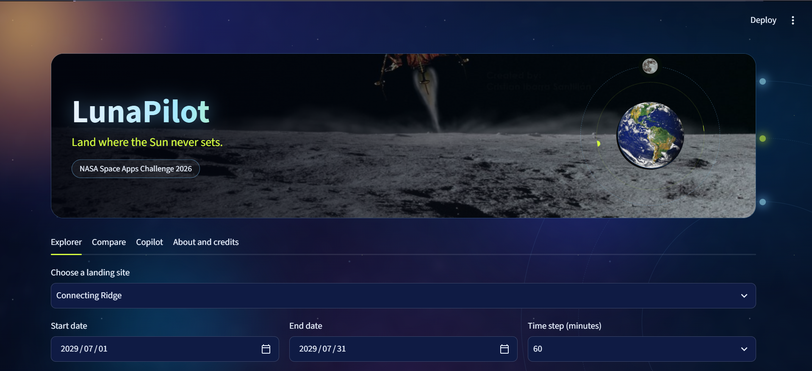
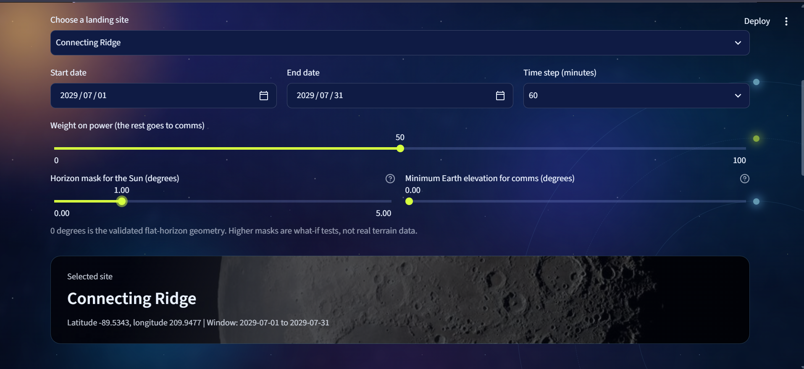
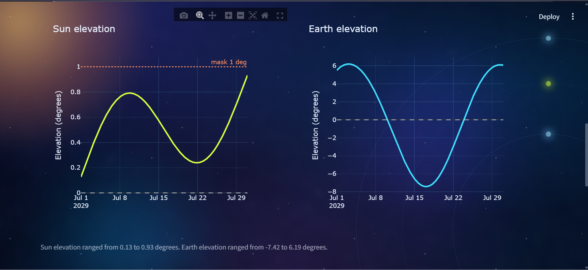
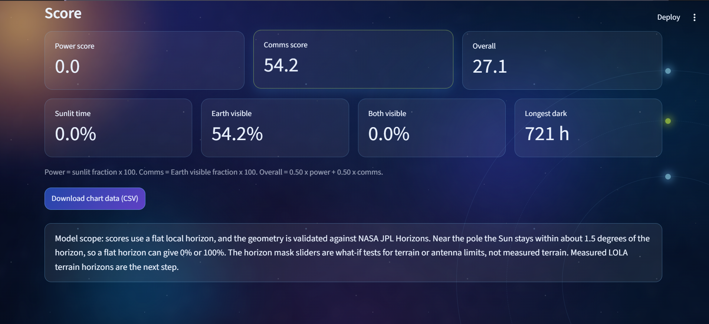
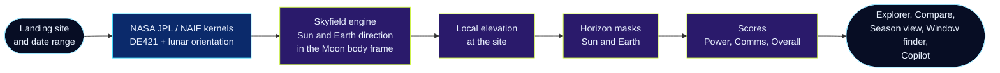
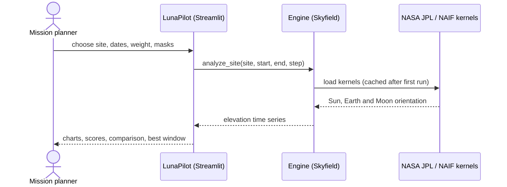

<div align="center">



<br/>

[](https://lunapilot-28tiyt7dwmst4pknnzkqzp.streamlit.app/)
[](docs/horizons_validation.txt)
[](requirements.txt)
[](LICENSE)

**Choose where and when to land near the Moon's south pole, using real NASA JPL data.**

[Live app](https://lunapilot-28tiyt7dwmst4pknnzkqzp.streamlit.app/) · [How it works](#-how-it-works) · [Validation](#-validation) · [Run it locally](#-run-it-locally) · [How to test](#-how-to-test) · [Team](#-team)

</div>

---

## 🌙 At a glance

| | |
|---|---|
| **Challenge** | NASA Space Apps Challenge 2026, Lunar Landing Site Navigator |
| **Team** | Sunlit Signal (Pakistan and Uganda) |
| **What it does** | Computes Sun and Earth elevation at lunar south pole sites for any date from 1900 to 2050, and turns it into power and communication scores |
| **Data** | NASA JPL / NAIF ephemerides and Moon orientation kernels, Artemis III candidate regions |
| **Proof** | Matches NASA JPL Horizons to 0.000 degrees on 3 sites (24 hours, hourly samples) |
| **Stack** | Python, Skyfield, Streamlit, Plotly, pandas |

## 📸 Screenshots

<table>
  <tr>
    <td width="50%"><br/><sub><b>Home.</b> Hero, tabs and site selector</sub></td>
    <td width="50%"><br/><sub><b>Explorer.</b> Dates, weights and horizon masks</sub></td>
  </tr>
  <tr>
    <td width="50%"><br/><sub><b>Elevation charts.</b> Sun and Earth over a month</sub></td>
    <td width="50%"><br/><sub><b>Scores.</b> Power, comms and overall</sub></td>
  </tr>
</table>

## 🎯 The problem

Landing near the lunar south pole is hard for two reasons:

- 🔆 **Power.** The Sun stays within a few degrees of the horizon, so a site can be lit for weeks or dark for weeks, depending on the exact place and date.
- 📡 **Communication.** The Earth is only sometimes above the horizon, so a lander can lose its direct link to Earth for days.

Mission planners need a quick, trustworthy way to compare candidate sites and dates. A wrong Sun or Earth position means a wrong decision, so correctness comes first.

## 🚀 Our solution

LunaPilot takes a **landing site** and a **date range**, asks real NASA ephemerides where the Sun and Earth are, and shows how much of the time each one is above the horizon.

### ✨ Features

| Feature | What you get |
|---|---|
| 🧭 **Explorer** | Sun and Earth elevation charts for any site and date range, with CSV download |
| ⚖️ **Scores** | Power score, comms score and an overall score with an adjustable weight, plus longest dark period |
| 🆚 **Compare** | Side by side table and chart for several sites |
| 📅 **Season view** | Month by month sunlit and Earth visible share through a full year |
| 🔎 **Mission window finder** | The best run of consecutive days in a year for each site |
| 🏔️ **Horizon masks** | What-if sliders that raise the horizon for the Sun and for Earth, to test terrain or antenna limits |
| 💬 **Copilot** | A rule-based assistant that answers from the engine's numbers (no language model, no invented values) |
| 📖 **About** | Data sources, validation, credits, use of AI |

## ⚙️ How it works



### The score

```
Power score   = share of time the Sun is above the Sun mask     x 100
Comms score   = share of time the Earth is above the Earth mask x 100
Overall score = w x Power + (1 - w) x Comms        (w = power weight, default 0.5)
```

With the default masks of 0 degrees this is a flat local horizon. The masks let you ask: *what if terrain or an antenna limit raised the horizon by a degree or two?*

### Example result

Connecting Ridge, 2029-07-01 to 2029-07-31, flat horizon, weight 0.5:

| Sun elevation | Earth elevation | Sunlit | Earth visible | Overall |
|---|---|---|---|---|
| 0.13 to 0.93 degrees | -7.42 to 6.19 degrees | 100.0% | 54.2% | 77.1 |

The Sun grazes the horizon all month. Raising the Sun mask to 1 degree drops the sunlit share to 0%, which shows why a real horizon matters.

### Using the app



## ✅ Validation

We checked our engine against the **NASA JPL Horizons** system. For every site we compared the Sun and Earth elevation, hourly, over 24 hours on 2029-07-01.

| Site | Body | Max difference | Mean difference | Samples |
|---|---|---|---|---|
| Connecting Ridge | Sun | 0.000 deg | 0.000 deg | 25 |
| Connecting Ridge | Earth | 0.000 deg | 0.000 deg | 25 |
| Peak Near Shackleton | Sun | 0.000 deg | 0.000 deg | 25 |
| Peak Near Shackleton | Earth | 0.000 deg | 0.000 deg | 25 |
| Nobile Rim 2 | Sun | 0.000 deg | 0.000 deg | 25 |
| Nobile Rim 2 | Earth | 0.000 deg | 0.000 deg | 25 |

The full log is in [`docs/horizons_validation.txt`](docs/horizons_validation.txt). Re-run it any time with `python check_horizons.py`.

> This validates the **geometry** (where the Sun and Earth are). It does not validate terrain, which is not modelled by default. See [Model scope](#-model-scope-and-roadmap).

## 🛠️ Run it locally

You need Python 3.11 and an internet connection for the first run.

```bash
git clone https://github.com/ailanasirai/lunapilot.git
cd lunapilot

python -m venv .venv
# Windows PowerShell:  .\.venv\Scripts\Activate.ps1
# macOS / Linux:       source .venv/bin/activate

pip install -r requirements.txt
streamlit run app/streamlit_app.py
```

The first run downloads about 18 MB of NASA kernels (4 files) into `~/.lunapilot_cache`. After that it works from the cache.

## 🧪 How to test

1. **Unit tests** (score logic, masks, monthly table, window finder, bad input):

   ```bash
   python tests/test_analysis.py
   ```

   You should see `ok` for every test.

2. **Check against JPL Horizons** (needs internet, takes a minute or two):

   ```bash
   python check_horizons.py
   ```

   The Sun and Earth `max diff` lines should read `0.000 deg`.

3. **Try the app.** In the Explorer tab choose Connecting Ridge, set the Sun mask to 1 degree, and watch the sunlit share fall.

## 🧰 Troubleshooting

| Problem | What to do |
|---|---|
| `No such file` when running tests | Run the command from the project root (the folder that contains `app/`, `engine/` and `tests/`) |
| First run is slow | The kernels (about 18 MB) are downloading. Wait once, later runs are fast |
| Download fails | Check your internet connection and run again. A partial file in `~/.lunapilot_cache` can be deleted |
| Dates rejected | Dates must be between 1900-01-01 and 2050-01-01 (kernel coverage), and a window is at most 366 days |
| `pip install` fails on a version | Use Python 3.11 and a fresh virtual environment |

## 🗂️ Project structure

```
lunapilot/
├── app/
│   ├── streamlit_app.py      # the web app (UI, charts, copilot)
│   └── assets/               # images (credits in docs/credits.md)
├── engine/
│   ├── geometry.py           # Skyfield + NASA kernels: analyze_site, load_sites
│   ├── metrics.py            # engine-side metrics
│   └── analysis.py           # scores, masks, monthly table, best window
├── data/
│   └── sites.json            # candidate sites, coordinates and sources
├── tests/
│   └── test_analysis.py      # unit tests
├── docs/
│   ├── banner.svg
│   ├── screenshots/          # images used in this README
│   ├── horizons_validation.txt
│   └── credits.md
├── check_horizons.py         # validation against NASA JPL Horizons
├── check_engine.py, check_months.py   # engine sanity checks
├── .streamlit/config.toml    # dark theme
└── requirements.txt
```

## 🧭 Model scope and roadmap

**Model scope (what it is today)**

- The default horizon is flat. Near the pole the Sun stays within about 1.5 degrees of the horizon, so a flat horizon can give 0% or 100%.
- The horizon mask sliders are **what-if tests**, not measured terrain.
- Landing region coordinates are approximate region centres taken from the papers listed in [`data/sites.json`](data/sites.json).

**Roadmap**

- [ ] Measured terrain horizons from LRO LOLA data (via NASA Moon Trek and Quickmap)
- [ ] More Artemis III candidate regions
- [ ] Optional language-model copilot that calls the engine as a tool

## 🤖 Use of AI

We used Claude (Anthropic) as a coding and writing assistant for parts of the app code, the unit tests and this document. All numbers shown in the app come from our own engine and NASA data, and were checked against NASA JPL Horizons by the team. The in-app Copilot is rule-based and does not call a language model. The banner graphic and the app's visual design were created with AI assistance.

## 📚 Data sources and credits

- **NASA JPL / NAIF**: DE421 planetary ephemeris, lunar orientation kernels (`moon_pa_de421_1900-2050.bpc`, `moon_080317.tf`) and planetary constants.
- **NASA JPL Horizons**: used to validate the engine.
- **NASA Artemis III candidate landing regions**: region names.
- **Skyfield**, **Streamlit**, **Plotly**, **pandas**, **NumPy**, **Pillow**.
- **Images**: Pixabay, see [`docs/credits.md`](docs/credits.md).

## 👥 Team

**Sunlit Signal** · NASA Space Apps Challenge 2026

| Member | Role |
|---|---|
| **Aila Nasir** ([@ailanasirai](https://github.com/ailanasirai)) | Team lead, app and product |
| **Ekeu David** ([@Ekeudj](https://github.com/Ekeudj)) | Engine |
| **Umar Akhtar** | Team member |

## 📄 License

MIT, see [LICENSE](LICENSE). Copyright (c) 2026 Aila Nasir.

<div align="center">

<sub>Built for NASA Space Apps Challenge 2026. This project is not affiliated with or endorsed by NASA.</sub>

</div>
